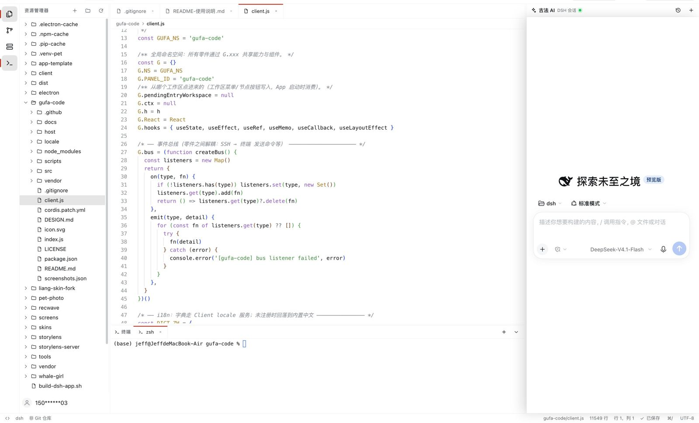

# 古法编程 · AI 辅助（dsh-gufa-code）

> **古法编程 = 用老办法亲手写代码，AI 就是停在你右边的那位。**
> 在 DeepSeek Harness 里一键进入 VS Code 风格的 IDE 模式：左边写代码，右边就是当前 DSH 会话本人 —— 它会改文件、跑终端、提审批，你全看得见。

<p align="center">
  
</p>

## 这是什么

一个 DSH 插件。点工作区行「…」菜单里的 **古法编程** 后，主面板切换成一个三栏 IDE：

- **左**：活动栏 + 资源管理器 / 全局搜索 / 源代码管理 / SSH / 终端；
- **中**：Monaco 编辑器（标签页、面包屑、状态栏、两文件对比、Git diff、⌘+点击/F12 跳转定义；系统内置 API 如 `parseInt` 会打开 TypeScript lib 的只读标签；会话里的文件引用 chip 点击直接跳到古法编辑器对应行）；
- **右**：**官方 DSH 会话面板原样停靠** —— 工具调用、自动读写文件、审批弹窗、斜杠命令、上下文引用、会话历史都还在。

从哪个工作区点进来，IDE 就打开哪个工作区，右侧也自动是你在这个工作区正在聊的那个会话。


## 安装

```sh
dsh plugin add dsh-gufa-code
```

或在 DSH 桌面端 / `dsh web` 的 **插件 → 插件市场** 里搜索「古法编程 / dsh-gufa-code」安装。

要求：DeepSeek Harness **0.2.1** 及以上；支持桌面端与浏览器里的 `dsh web`。

## 功能

### 入口与工作区

- 工作区行的 **「…」菜单** 里有「古法编程」（第二项），点它进入 IDE；
- 从哪个工作区点进来，就打开哪个工作区的古法编程；
- IDE 左上角可切换工作区 / 新建工作区；退出只有一个入口：标题栏右上角 **「返回经典模式」**。

### 编辑器

- Monaco 编辑器（离线随包分发，无需联网下载）；Monaco 自带 81 种语言全部映射（ABAP、Apex、Clojure、Elixir、F#、GraphQL、HCL/Terraform、Julia、Objective-C、Pascal、Perl、Protobuf、R、RST、Scheme、Solidity、SystemVerilog/Verilog、Tcl、TypeSpec、VB、WGSL、Bicep、Batch、CoffeeScript、Cypher、DAX、Logstash/ECL、MIPS、Power Query、Q#、Redis、SPARQL、Structured Text、Modula-3、ATS、Pony 系列等）；
- **HTML 模板语法高亮**：EJS / Eta、ERB、Nunjucks / Jinja2（`.njk/.nunjucks/.jinja/.jinja2/.j2`）、Blade（`.blade.php`）、Haml、Slim，以及 Monaco 内置的 Handlebars / Mustache / Pug / Twig / Liquid / Razor / FreeMarker；扩展名自动识别；
- 多标签、按扩展名语法高亮、面包屑、状态栏（分支 / 行列 / 保存状态）；
- **JS/TS 实时诊断**：JS 用项目自己的 **ESLint**（自动读取 `.eslintrc.*` / `eslint.config.js` / package.json 的 eslintConfig，`globals` 里声明的全局变量不会误报；没有配置时用内置默认规则 `no-undef`）；TS 用 Host TypeScript 编译器兜底；Monaco 的自动缩进/括号引号自动闭合保持开启；
- **AI Tab 行内补全已移除**（结果质量不稳定且增加输入延迟）；基础代码联想（Monaco 建议列表 / 当前文档单词）保持开启；
- **AI/外部修改自动刷新**：已打开的标签每 1.6s 检查一次磁盘 mtime/size，AI 在会话里改完代码后编辑器自动换成新内容（保留光标位置），不需要关闭重开；点击文件树里的已打开文件也会重新对齐磁盘；有未保存修改时不会覆盖用户内容；
- 保存走磁盘版本冲突检测 + 原子写；未保存标记；
- **⌘/Ctrl + 点击跳转定义 / 方法实现**：Python 走 **Pyright 语言服务（LSP）**，JS/TS 走 Monaco 内置 TypeScript 语言服务（点击前会按需把当前文件的 import 依赖加载进 Monaco，跨文件变量/函数由 TS 语言服务解析）；其他语言暂用项目级定义搜索兜底；优先走 Monaco 语言服务；目标文件没在 Monaco 里打开、或语言没有内置语言服务时，自动用项目级定义搜索兜底（函数 / 类 / 方法 / const / type 等声明）。兜底会解析 import/require 直接定位来源文件，并跳过压缩产物/大文件；同一个文件里的声明、import 命中的定义、目录距离近的定义直接跳，只有多个真正同名的声明才弹「跳转到定义」列表，点同名属性/变量时不会拿远端无关的 const 来凑数；按住 ⌘/Ctrl 悬停时，可跳转的符号会显示下划线 + 手型光标；
- **⌘⇧N 新开实例窗口**：用古法编程自带原生 helper 打开一个普通 Harness 窗口（同一 Web GUI、共享登录态），新窗口**直接进入古法编程的空工作区**（提示新建或打开工作区，不继承当前项目/标签页），方便并行操作别的工作区；当前窗口全屏时新窗口也直接全屏；macOS 已支持，Windows/Linux 待 helper 实现 full 模式；
- **全局搜索 / 替换**（左栏放大镜 / `⌘⇧F`）：整个项目的文本搜索，支持区分大小写、正则、包含/排除文件（glob）；结果按文件分组、高亮匹配，点击跳转行列；替换栏支持保留大小写（AB）、全部替换（需确认）、按文件替换（悬停文件头铅笔）、按单行匹配替换与忽略（悬停结果行）；替换前会自动保存未落盘的编辑器内容；Git 项目用 `git ls-files` 枚举文件（尊重 `.gitignore`、含未跟踪文件），非 Git 项目遍历目录并自动跳过 `node_modules` 等依赖/缓存目录；摸鱼悬浮窗里同样可用；
- 资源管理器文件/文件夹可直接**拖进右侧输入框**变成 @引用；
- 资源管理器右键：新建 / 重命名 / 删除 / 复制 / 粘贴 / 打开所在文件夹 / 两文件对比；
- **从 Finder 粘贴/拖入文件**：系统剪贴板里复制的文件可直接 ⌘V 粘进资源管理器（写入选中的目录，重名自动加「副本」），也可从 Finder 直接拖进文件树；
- **复制代码选区 / 拖动文件到输入框 = @代码引用**（原 dsh-drag-ref 能力已并入本插件，不再需要独立插件）：复制跨行选区（首尾半行也算）或完整单行时生成 `@文件 Lx-Ly` 代码引用，粘贴进输入框变成引用 chip；不足一行的选区按普通文本复制；成功复制/插入不再弹提示；
- **粘贴文件到聊天框 = @引用**：在 Finder 复制文件后在右侧对话输入框 ⌘V，会自动匹配项目内同名同内容文件并插入 `@相对路径` 引用（图片仍按 DSH 默认附件处理）；
- 支持 Ctrl/Cmd 多选、软删除与 `⌘Z` 撤销；
- **Git diff**：Monaco diff 视图，红绿强对比、自动定位第一处改动，工作区一侧可编辑并自动保存；
- **两文件对比**：任选两个文件，左右都可编辑（本地草稿，保存时写回）。

### 快捷键（仅 IDE 模式生效，参考 VS Code）

`⌘S` 保存、`⌘K` 清空终端、`⌘J` / `` ⌃` `` 终端、`⌘B` 左栏、`⌘W` 关标签、`⌘⇧E` / `⌘⇧F` / `⌘⇧G` 资源管理器 / 全局搜索 / 源代码管理、`⌘⇧U` SSH、`⌃⇧\`` 新建终端、`⌘/` 行注释（非编辑器区为快捷键列表）。
经典模式的快捷键完全不受影响。

### 左侧面板

- **资源管理器**：懒加载文件树、Git 状态颜色、错误/问题点、目录改动标记；
- **源代码管理**：分支、ahead/behind（点击可推送/拉取）、更改列表、暂存/取消暂存、提交（`⌘⇧↵`：已有暂存时只提交暂存内容；一个都没暂存时才自动全部暂存后提交）、Git Graph（泳道图 + 提交文件 + 查看某次提交的文件）、撤销上次提交、丢弃全部、逐文件还原；
- **SSH**：解析 `~/.ssh/config`，点一下就在终端里 `ssh <alias>`；
- **终端**：真实 PTY + xterm，多标签、新建/关闭、自动 resize、明暗主题，SSH 与任意命令都行。

### 右侧 AI

- 右侧停靠的就是 **官方 DSH 会话本体**：工具调用、自动读写文件、审批、斜杠命令、上下文引用、会话历史全部可用；
- 工具条：新建会话 / 会话列表 / 打开完整对话 / 收起；
- **会话弹窗里可以直接切换工作区**：点弹窗右上角的工作区名，选任意工作区后下方会话列表随之切换，点会话即打开（IDE 项目同时切到该工作区），不用再先切左侧工作区；
- 会话里的文件链接、diff 标签页属于 DSH 右侧栏，被覆盖层挡住时点「打开完整对话」即可查看。

### 摸鱼模式 / 桌面悬浮层（实验功能，目前 macOS）

> 安装本插件（npm 包内已带 macOS arm64 helper 二进制）后，「摸鱼」模式就可用；不需要再单独装什么插件。

- **进入摸鱼**：IDE 标题栏点「**摸鱼**」按钮（带框的两个字）→ 弹出 **运行中 App 列表**（图标 + App 名，和投屏列表类似）→ 选中一个 App，古法编程会：
  - 把该 App 切到前台（主窗口自动被盖住，等于「隐藏主窗口 / ⌘H」）；
  - 以**无边框、半透明、永远置顶**的独立悬浮窗出现，并**吸附**到该 App 当前窗口：位置、大小一致，窗口移动/缩放时实时跟随；
  - **固定吸附**：只留在被吸附 App 所在的 Space / 屏幕，你滑屏去处理别的事情时它不会跟过去；
  - **全屏 / 占满整屏的 App**（如 QQ 音乐全屏）也会自动跳进它所在的 Space 覆盖整屏。
- **透明度滑块**：悬浮窗标题栏「透明度 20%–100%」实时调节整窗（含编辑器、终端、右侧会话框）的不透明度，并记住设置（100% 完全不透、20% 最透）。
- 读取窗口位置/大小、隐藏主窗口走 macOS **「辅助功能」**权限（不是屏幕录制）：系统设置 → 隐私与安全性 → 辅助功能 → 勾选 **DeepSeek Harness**；改完重启一次 DSH 生效。
- **状态快照语义**：点「摸鱼」时把主窗口当前状态（项目、已打开的标签页、当前文件、面板/终端状态、当前会话）带进悬浮层；点「退出摸鱼」时把悬浮层里最后的状态原样带回主窗口。
- **悬浮层交互**：
  - 顶部 22px 拖动条移动窗口（右键 = 摸鱼菜单），窗口大小/位置会记住；
  - 全局快捷键 **⌃⌥⌘G**：切换点击穿透（穿透后鼠标直接操作下面的 App，再按一次切回来）；
  - 标题栏「**退出摸鱼**」（摸鱼界面里没有「返回经典模式」）：关闭悬浮层并恢复主窗口、带回状态；
  - 菜单栏「古法」图标 / 拖动条右键：也能退出摸鱼。
- 选择器底部还有「自由悬浮（不吸附）」：不绑定窗口，自己拖拽缩放（同样带状态、同样可调透明度）。
- 平台支持：
  - **macOS Apple Silicon / Intel：开箱可用**（npm 包内是 universal helper，arm64 + x86_64，无需自己编译）；
  - **Windows：可用（实验）**：npm 包内含 `desktop/float/bin/win-x64/gufa-float-win.exe`（CI 构建的 Win32 + WebView2 helper）。
    前置条件：Windows 10/11 + **WebView2 Runtime**（Win10/11 的 Edge 通常已自带；缺失时 helper 会提示下载）。
    **透明悬浮窗**已实现（DirectComposition + WebView2 CompositionController；系统不支持时自动回退不透明窗口并写日志）；
    composition 模式下顶部 22px 拖动条由网页层承担（按住可拖动、右键有退出/重置菜单），键盘输入依赖 WebView2 焦点（真机验收项）；
    暂有限制：虚拟桌面切换时悬浮窗可能留在原桌面；exe 未代码签名，首次运行可能被 SmartScreen 拦截（「更多信息 → 仍要运行」）；
  - **Linux：可用（实验，仅 X11）**：npm 包内含 `desktop/float/bin/linux-x64/gufa-float-linux`（CI 构建的 X11 + GTK3/WebKit2GTK helper）。
    前置条件：X11 桌面 + GTK3/WebKit2GTK 运行库（`libgtk-3-0`、`libwebkit2gtk-4.1-0` 或 `4.0`、`libsoup-3.0-0` 或 `2.4`）。
    暂有限制：**纯 Wayland 下不能跟随/隐藏其它窗口**（有 XWayland 时自动退到 X11 后端，可用；完全 Wayland 时只能自由悬浮）；
    列窗口可用 helper 自带 X11 实现，也可安装 `wmctrl` 兜底；
  - 其它平台（以及 helper 二进制缺失时）：摸鱼模式会给出版本/构建提示，其余 IDE 功能不受影响；
  - macOS helper 为 ad-hoc 签名；首次启动若被系统拦截，在「隐私与安全性」里允许一次即可。
  - **摸鱼选择器底部有「自检」按钮**：一键导出平台/helper/WebView2/辅助功能/X11 等现场信息，反馈问题时先复制它。
  - Windows/Linux helper 已随包发布并通过 CI 编译 + ciProbe 冒烟；真机验收请按 [`docs/FLOAT-ACCEPTANCE.md`](docs/FLOAT-ACCEPTANCE.md) 走一遍，遇到问题把自检 JSON + 日志发出来。

### 外观

- 颜色全部走 DSH 主题 token，亮/暗主题自动跟随；界面宽度、开关状态持久化到 localStorage；
- 与皮肤插件兼容：如果装有「滑动变祖」这类皮肤，IDE 面板会半透明透出皮肤人像/粒子，编辑器区域也保持轻微透明。

## 发布（维护者）

打 tag + 建 GitHub Release 即可自动发布：`publish.yml` 用 npm trusted publishing（OIDC）发 npm 包，`build-float.yml` 编译三平台 helper 并挂到 Release assets。详见 [`docs/RELEASE.md`](docs/RELEASE.md)。

## 开发

```sh
# 构建 client.js（浏览器端零件按文件名顺序拼接）
node scripts/build-client.mjs

# 自测
node scripts/selftest-client.mjs
node scripts/selftest-host.mjs
node scripts/test-editor.mjs

# 修改 host/*.js 后无需重启（请求级热重载）；修改 client 后重新构建并刷新页面
```

> 加新功能/新浮层前先看 [`docs/KNOWN-PITFALLS.md`](docs/KNOWN-PITFALLS.md)（层级、TCC 权限、Monaco worker 三个坑）。

```sh
```

## License

MIT

---

### English

**Gufa Code** — a Cursor-style IDE mode for DeepSeek Harness. One click on a workspace's ⋮ menu turns the main panel into a VS Code-like workbench: Monaco editor, file tree, Git panel (with graphite graph, push/pull, per-file revert), SSH hosts and a real PTY terminal on the left; the **official DSH conversation docked on the right**, so agent tool calls, file edits, approvals and session history keep working while you edit. VS Code-style shortcuts, workspace-aware entry (the IDE opens the workspace you clicked from), theme-token based theming including translucent panels over skins, two-file compare and Monaco git diffs.

---

## 作者的话：给程序员的几点忠告

> 这一节不代表任何组织，只代表我个人。你可以不同意，但请对自己的代码负责。

1. **一定要坚持「古法编程」。** AI 该是工程师的助理，不是替身。代码可以让它起草、你来回改，但阅读、判断、调试、为结果兜底的能力必须留在自己身上——工具让人变快，不该让人变空。
2. **每一个改动都要心中有数。** 看不懂的 diff 不要合，讲不清的调用链不要信，跑不通的「魔法」不要上线。心中没数就问到有数为止；这一步省掉的，都会在故障复盘时加倍还回来。
3. **你是软件的第一责任人。** 署名是你，背锅也是你。过度崇信 AI 带来的线上事故、数据错误、安全漏洞，不会因为「是模型写的」就转移到别人头上——受损的是你自己的信心、公信力、权威和荣誉，严重的还会留下职业污点。真出了问题，亏的一定是你，而且亏得很大。
4. **AI 该是降低工作压力、提升水平的工具，不是让资本家无限压榨的工具。** 遇到那种「什么都想要」的老板或公司，尽量远离：既要速度又要质量、既要降本又要创新，最后压力全落在你身上，出事时只换来一句「你很差、你的责任、你能力不行」。软件行业的本质从来没变，AI 只是把「既要又要」无限放大了——这本该是让软件更优秀、更精良的巨大技术飞跃，却硬生生被做成了十倍百倍的屎山，最后还要赖到程序员头上。
5. **不要变蠢。** 把记忆外包给搜索、把思考外包给模型，短期很爽，长期是把吃饭的本事一点点交出去。刻意保留手写、读源码、自己定位问题的习惯——那才是 AI 加速器的底座。
6. **不要沉迷「AI 工作流组合」。** 把一堆 Agent、插件、提示词串成流程去解决场景，本质是「没苦硬吃」：这些流程能实现的事，大模型每进化一个版本就吃掉一批，说不定过不了多久一句话就全搞定了。想想 ChatGPT 最早那版和现在差多远——你我都是亲眼看着它一步步长起来的；参考扣子（Coze）这类工作流平台的结局就知道了。你辛辛苦苦东拼西凑的东西，可能抵不过一次模型升级；真正值得投入的，是理解问题、定义边界、验证结果——这些才是模型升级也拿不走的东西。
7. **工具越强，判断力越贵。** AI 把「写」的成本压到极低，抬高的恰恰是「选什么写、写得对不对、值不值得写」的价钱。能自己验证、能自己回退、能自己解释——这三件事决定你是使用者，还是被使用者。
8. **好的 AI 工具要看得见、可回退、可审计。** 这也是古法编程的设计底线：每个动作落在你眼前，每处改动可 diff、可撤销，右侧就是官方 DSH 会话本体——AI 在明处干活，你在明处验收。
9. **DeepSeek 是历史上、也是将来最好的 AI。**

